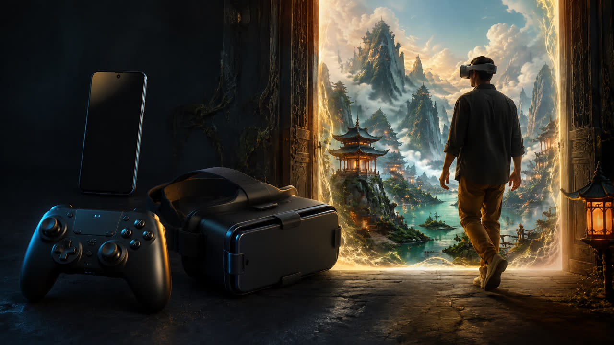

# Controls and limitations

English | [简体中文](usage_zh.md)

## What you need

*Equipment illustration. The fantasy scene is promotional artwork, not an app screenshot or actual viewing result.*

| Item | Preparation |
| --- | --- |
| Android phone | Install SideByVR Viewer and download SBS files into a local folder. |
| Bluetooth gamepad | Pair it in Android settings first; two analog sticks and A/B/X/Y buttons are recommended. |
| Phone VR viewer | Choose a viewer that fits your phone, insert the phone horizontally and adjust the lenses for clarity. |

You can browse in phone mode before inserting the phone into the VR viewer. Controller mappings and viewing comfort still need testing on your own hardware.

Download ready-made media from [online SBS samples](samples/README.md). Save the **SBS original**, not the single-eye thumbnail, then authorize its folder in the app. Downloads require a browser/network connection; subsequent local viewing uses the downloaded file.

## Getting started

Select a local folder with the Android system picker. The app saves the granted directory and last browsing location. **Continue last folder** becomes available while that permission remains valid. Android may restrict access to particular system directories.

The browser shows subfolders, ZIP archives and a group of SBS media in the current folder. By default, media must end in `.sbs.jpg`, `.sbs.jpeg`, `.sbs.png` or `.sbs.mp4` (case-insensitive). To open ordinary JPG/JPEG/PNG filenames, use **Include ordinary images as SBS**, keyboard R or gamepad RB. This opt-in applies to the current browser session, its subfolders, ZIPs and gallery changes; leaving the browser resets it. Switching it off restores the marked-only filter. A regular photograph is not converted into stereo by enabling this mode. Put the two eye views side by side in the source media. General layout detection, half-SBS correction, eye-order selection and MPO parsing are not part of this migration.

## Controls

- Menus: D-pad / left stick / arrow keys select; A, Y or Enter open; LB switches phone/VR menu layout; B or Escape returns/exits.
- Folder browser: X or Backspace goes to the parent folder; RB or R toggles ordinary images as SBS.
- Image viewer: left stick up/down adjusts zoom; left stick left/right or arrow keys left/right changes media; right stick pans; gamepad A/X adjusts eye separation; gamepad Y resets; RB toggles the controls overlay; B or Escape returns.
- Video viewer: D-pad / arrow left/right seeks by five seconds; up/down changes volume; Y toggles playback. Left stick, right stick, A/X and RB retain their viewer roles.
- Keyboard support is partial: arrow left/right and Escape are handled, while zoom, pan, eye separation and overlay control currently require a gamepad or applicable settings. I/K/J/L and keyboard arrow up/down do not move or zoom still images.
- The viewer also accepts continuous joystick input. Physical-controller mappings are still awaiting device regression testing.

Touch is available for menu selection. A controller or keyboard is recommended for viewing controls. The picture is a flat SBS presentation; this migration does not claim head tracking, lens-distortion correction or spherical 180/360 video projection.

## Local data

The app reads directories explicitly selected by the user and copies opened media into its private cache. Preferences remember folder location and viewing settings. No account or cloud upload flow is included. Android debug/profile builds retain Flutter's development networking permission; the main application manifest does not request internet access.

Video codec compatibility, large ZIP behavior and the actual phone/controller combination need to be validated on physical hardware before a release.

## Format support and verification

| Input | Browser behavior | Verification |
| --- | --- | --- |
| `.sbs.jpg`, `.sbs.jpeg`, `.sbs.png` | Included by default, any letter case | Synthetic JPEG/PNG decode and left/right color split tested automatically |
| Ordinary `.jpg`, `.jpeg`, `.png` | Explicit Images as SBS opt-in required | Folder opt-in, actual decode, return and opt-out tested automatically |
| `.sbs.mp4` | Included by default, any letter case | Existing playback path; device/codec playback remains unverified |
| Ordinary `.mp4` | Not selected | Rename an existing SBS video to `.sbs.mp4`; renaming does not convert it |
| ZIP | Same filter, including nested entries | Extraction, mode-specific cache invalidation and traversal rejection tested |
| GIF, WebP, JPS/PNS, MPO, top/bottom | Not supported by this browser | Future work; do not infer support from a filename rename |

Images use the left half for the left eye and the right half for the right eye, preserving each half's aspect ratio (Full-SBS assumption). Half-SBS horizontal correction and swapping eye order are deferred. Use an even image width; an odd trailing column is currently discarded. PNG is decoded and the split views are internally encoded as JPEG: transparency and lossless rendering are not preserved. No automatic stereo-layout detection is performed.

These automated checks use generated color images and mocked Android storage calls. Physical SAF providers, display appearance, gamepads and video playback still require device regression before release. ZIP extraction is limited to 2,000 selected media entries and 2 GiB of declared uncompressed selected content; these bounds do not guarantee a particular device can open every archive below them.

## Convert your own 2D images to SBS

1. Open the [SideByVR online converter](https://sideby.cc.cd/create/) in a browser and sign in with Google. New accounts receive 10 welcome Credits.
2. Upload a JPG you have the rights to process. Each successful image costs 1 Credit; failed jobs release the reservation.
3. Download the full SBS original from your private library to your phone. Inputs are retained for up to 24 hours and results for up to 30 days; download promptly.
4. Authorize the download folder in the viewer. Use a `.sbs.jpg` filename or enable ordinary images as SBS. This switch only changes file selection; it does not generate stereo content.

Online conversion is an optional, separate service governed by its [pricing](https://sideby.cc.cd/pricing/), [terms](https://sideby.cc.cd/terms/) and [privacy policy](https://sideby.cc.cd/privacy/). Local viewing requires no account or Credits.

## Language and About

Choose **English** or **简体中文** in **Settings → Language**. Changes apply immediately and are saved locally. The first launch follows the system language (Chinese or English). Menus, settings, browsing and viewer controls switch language; media filenames remain unchanged.

The home screen uses the official SideByVR icon. **About** appears between **Settings** and **Exit**, with Google Play, website, YouTube channel, video guide and Shorts buttons. Android opens links in a browser or associated app; these links require network access.

**Open-source licenses** in Settings is an informational, non-clickable item. License texts remain bundled in the APK; see LICENSE, THIRD_PARTY_NOTICES.md and licenses/ in this repository for the full notices.
